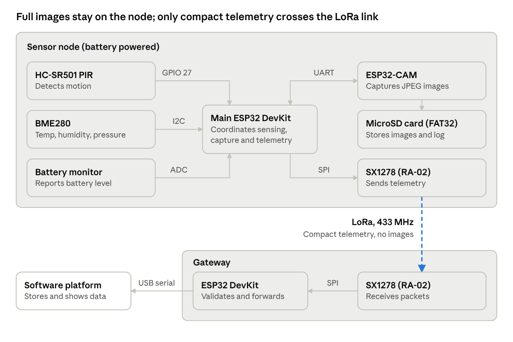
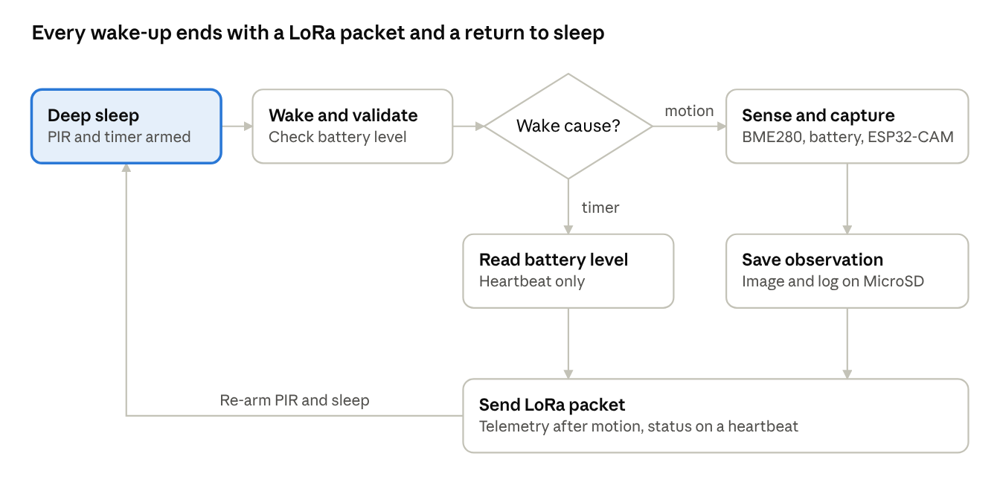

# NETH System Requirements Specification

Nov 7, 2026

## 1. Introduction

### 1.1 Purpose

This specification defines what the Networked Ecological Telemetry Hub (NETH) must do and how each requirement will be verified. It is the baseline for design, build and acceptance testing in the CO3060 Cyber-Physical Systems project. Its readers are the project team and the supervisor, Ms. Yasodha Vimukthi.

### 1.2 Scope

NETH is a low-power wildlife monitoring system. A battery-powered sensor node detects motion, captures an image, records environmental conditions and stores the observation locally. It then sends a compact telemetry packet over LoRa to a gateway, which forwards the data to the software platform.

| In scope | Future extension (not required for acceptance) |
| --- | --- |
| One sensor node and one gateway | Multi-node and multi-hop (mesh) deployments |
| Motion detection, image capture and local storage | Edge AI image classification |
| Temperature, humidity and pressure sensing | Solar charging |
| LoRa telemetry from node to gateway, then on to a software dashboard | Transmitting images over LoRa (excluded by design) |
| Battery-powered operation and device health reporting |  |
| Modular prototype, custom PCB, BOM and power tree |  |

### 1.3 Requirement conventions

- **Shall** marks a mandatory requirement. **Should** marks a desirable one.
- Each requirement has a unique ID: FR (functional), NFR (non-functional), HR (hardware), IR (interface).
- **TBC** marks a value that must be confirmed by measurement or a team decision. Section 8 lists each one.

### 1.4 Definitions and abbreviations

| Term | Meaning |
| --- | --- |
| BME280 | Digital temperature, humidity and pressure sensor |
| BOM | Bill of Materials |
| ESP32-CAM | ESP32 module with a camera and MicroSD slot |
| Gateway | Base unit that receives LoRa packets and forwards them to software |
| HC-SR501 | Passive infrared (PIR) motion sensor module |
| LoRa | Long-range, low-bandwidth radio modulation |
| Observation | One motion event with its image, sensor readings and metadata |
| SX1278 (RA-02) | 433 MHz LoRa transceiver module |
| Telemetry packet | Compact observation or status message sent over LoRa |

### 1.5 References

1. NETH hardware and electronics implementation plan (team document).
2. NETH repository README: objectives, workflow, evaluation criteria and roadmap.
3. NETH project page (`docs/index.html`): architecture layers, firmware states, benchmarks, workflow figure and budget sheet.

## 2. Overall Description

### 2.1 Product perspective

NETH replaces manual camera-trap checks with a node that also reports what it sensed and how healthy it is. Conventional camera traps store images but give no environmental context and no remote view of device status. NETH keeps full images on the node and sends only compact telemetry, so a low-bandwidth radio link is enough.

### 2.2 Users

| User | Goal | Interaction with NETH |
| --- | --- | --- |
| Conservation researcher | Study animal activity against environmental conditions | Views the dashboard and analyses retrieved images and logs |
| Field operator | Keep nodes running in the field | Mounts the node, runs the diagnostic check, retrieves the MicroSD card |
| Project developer | Build, test and debug the system | Uses the gateway serial output, firmware and configuration file |

### 2.3 Operating environment

- **Sensor node:** outdoors, on a tree or stake 0.5 to 1.5 m above ground, facing active wildlife tracks. It runs from a battery with no mains power.
- **Gateway:** within LoRa range of the node, powered and connected by USB to a computer running the software component.
- **Software:** a computer or cloud service with a web dashboard.

### 2.4 Design constraints

- The radio link is low bandwidth, so images stay on the node.
- The SX1278 and ESP32 use 3.3 V logic. The SX1278 must never connect to a 5 V rail.
- Modules must plug into headers so they can be replaced without desoldering.
- The custom PCB is designed in Autodesk Fusion Electronics.
- The proposed budget is LKR 43,400 (see OI-04).
- Radio operation must comply with the regulations for the chosen band (see OI-02).

### 2.5 Assumptions and dependencies

- The node and gateway each have their own ESP32 controller and operate independently.
- Battery capacity is chosen only after real current consumption is measured.
- A MicroSD card formatted as FAT32 is installed before deployment.
- The software component accepts data from the gateway over USB serial.
- Firmware uses the Adafruit BME280 library for the environmental sensor.

## 3. System Architecture

NETH has three parts: a sensor node, a gateway and a software platform. The sensor node uses two controllers, so the main ESP32 handles sensing and radio while the ESP32-CAM handles imaging and storage.

### 3.1 System blocks

The main ESP32 coordinates every module on the node. The gateway has its own ESP32 and passes valid packets to the software platform over USB serial.

### 3.2 Sensor node operating cycle

The node spends most of its time asleep. A PIR interrupt starts a full observation, while the timer starts a short heartbeat. The observation is saved before the packet is sent, so a radio failure loses no data.

## 4. Functional Requirements

NETH has 26 functional requirements across seven areas. The Source column names where each came from: Plan (implementation plan, with section), README, Page (project page), Budget (its budget sheet), or Proposed (added here to close a gap).

### 4.1 Motion detection

| ID | Requirement | Source |
| --- | --- | --- |
| FR-01 | The sensor node shall detect movement in the monitoring area using the HC-SR501 PIR sensor. | Plan 4.1 |
| FR-02 | The sensor node shall register a motion event from the PIR digital output. | Plan 5.1 |
| FR-03 | The sensor node shall apply a cooldown after each motion event to prevent repeated capture requests. The default is 10 s. | Plan 5.1, Page |
| FR-04 | The sensor node shall wake from low-power sleep on a PIR interrupt. | Page |

### 4.2 Environmental sensing

| ID | Requirement | Source |
| --- | --- | --- |
| FR-05 | The sensor node shall read temperature, humidity and atmospheric pressure from the BME280 for each motion event. | Plan 5.1 |
| FR-06 | The sensor node shall check BME280 initialization at startup and handle communication failures. A failed reading shall be marked invalid in the record and shall not block image capture. | Plan 5.1, Proposed |

### 4.3 Image capture and local storage

| ID | Requirement | Source |
| --- | --- | --- |
| FR-07 | On a motion event, the main ESP32 shall command the ESP32-CAM over UART to capture an image. | Plan 5.2 |
| FR-08 | The ESP32-CAM shall store each captured image on the MicroSD card. | Plan 5.2 |
| FR-09 | The ESP32-CAM shall report capture success or failure to the main ESP32. | Plan 5.3, Proposed |
| FR-10 | Each stored image shall be linked to an observation record holding node ID, timestamp, temperature, humidity, pressure, battery level and image filename. | Plan 5.2, README |
| FR-11 | The node shall append each observation record to a log file on the MicroSD card. | Page |
| FR-12 | The node should support a configurable capture resolution up to UXGA (1600 x 1200) and a configurable burst count. The default burst is 3 frames. | Page |

### 4.4 LoRa telemetry

| ID | Requirement | Source |
| --- | --- | --- |
| FR-13 | The sensor node shall send a telemetry packet to the gateway after each observation, using the fields in Section 6.4. | Plan 5.3 |
| FR-14 | The sensor node shall save an observation locally before sending it, so a failed transmission loses no data. | Plan 5.3, Page |
| FR-15 | The sensor node shall not send image files over LoRa. | Plan 5.3 |
| FR-16 | The sensor node should send a heartbeat packet at a configurable interval. The default is 6 hours. | Page |

### 4.5 Gateway

| ID | Requirement | Source |
| --- | --- | --- |
| FR-17 | The gateway shall receive LoRa packets from the sensor node. | Plan 4.2 |
| FR-18 | The gateway shall check packet integrity and shall not forward corrupted packets as valid data. | Plan 5.3 |
| FR-19 | The gateway shall output received data over USB serial for monitoring and forwarding to the software component. | Plan 4.2 |

### 4.6 Device health and configuration

| ID | Requirement | Source |
| --- | --- | --- |
| FR-20 | The sensor node shall measure battery level for each observation and heartbeat. | README, Page |
| FR-21 | At power-on, the sensor node shall check the camera, sensors and MicroSD card, then show the result on a diagnostic indicator. | Page |
| FR-22 | The sensor node should read its operating parameters from a configuration file on the MicroSD card, so settings change without reflashing. | Page |
| FR-23 | The system shall handle radio and camera communication failures without an unrecoverable halt. The node shall return to its monitoring state. | Plan 5.3, Proposed |

### 4.7 Software platform

| ID | Requirement | Source |
| --- | --- | --- |
| FR-24 | The software component shall receive telemetry from the gateway and store it. | Plan 4.2, Page |
| FR-25 | The dashboard shall display observations and device health for each node. | Page |
| FR-26 | The dashboard should show when a node has missed its expected heartbeat. | Page, Proposed |

## 5. Non-Functional Requirements

Six measurable targets come directly from the project page benchmarks. Several may not be achievable with the selected hardware, so they carry TBC until measured.

### 5.1 Performance

| ID | Requirement | Target | Source |
| --- | --- | --- | --- |
| NFR-01 | Trigger latency from motion detection to frame capture shall stay within the target. | < 800 ms | Page |
| NFR-02 | The node shall reliably detect movement in range and should limit false triggers from foliage. | Detection and false-trigger rates TBC | README, Page |
| NFR-03 | BME280 readings shall agree with a reference instrument within the target. | ±0.4 °C and ±3 % RH, TBC (OI-08) | Page |
| NFR-04 | Every image shall match the correct observation record. | 100 % over a 72-hour simulated trigger test | Page |
| NFR-05 | LoRa packet delivery rate shall meet the target at range. | > 95 % at 2 km or more, TBC (OI-11) | Page |

### 5.2 Power

| ID | Requirement | Target | Source |
| --- | --- | --- | --- |
| NFR-06 | Sensor node sleep current shall stay within the target. | < 50 µA, TBC (OI-06) | Page |
| NFR-07 | Sensor node active peak current shall stay within the target. | < 180 mA, TBC (OI-07) | Page |
| NFR-08 | The battery shall sustain the required deployment duration, allowing for daily motion events and regulator efficiency. | Duration TBC (OI-13) | Plan 7.3 |

### 5.3 Reliability

| ID | Requirement | Target | Source |
| --- | --- | --- | --- |
| NFR-09 | The integrated system shall run continuously without unexpected resets. | 72 hours, proposed | Plan 8 |
| NFR-10 | Images and logs shall survive sudden voltage drops. Data shall be flushed to the MicroSD card after each observation. | No corrupted files in a power-loss test | Page |

### 5.4 Maintainability, environment and data protection

| ID | Requirement | Target | Source |
| --- | --- | --- | --- |
| NFR-11 | Each module shall be removable and testable on its own, without desoldering. | All plug-in modules | Plan 6 |
| NFR-12 | The sensor node shall sit in a weatherproof enclosure suitable for outdoor mounting. | Rating TBC (OI-13) | Page |
| NFR-13 | The node should not disturb wildlife. It should not fire a visible flash during capture. | ESP32-CAM flash LED disabled (OI-12) | Page, Proposed |
| NFR-14 | Dashboard access should be limited to authorized users, because sighting and location data can be sensitive. | Method TBC (OI-14) | Proposed |
| NFR-15 | The design should allow later addition of more nodes, Edge AI and solar charging without replacing the core architecture. | Design review | README |

## 6. Hardware and Interface Requirements

The baseline hardware is the implementation plan's two-controller sensor node and a separate gateway. Where other project sources differ, this specification follows the plan and records the conflict in Section 8.

### 6.1 Hardware requirements

| ID | Requirement | Source |
| --- | --- | --- |
| HR-01 | The sensor node shall comprise an ESP32 DevKit, HC-SR501 PIR sensor, BME280 sensor, ESP32-CAM, SX1278 (RA-02) and MicroSD card. | Plan 4.1 |
| HR-02 | The gateway shall comprise an ESP32 DevKit, SX1278 module and USB serial interface. | Plan 4.2 |
| HR-03 | The sensor node and gateway shall use separate ESP32 controllers. | Plan 4.2 |
| HR-04 | Each SX1278 shall receive a stable, regulated 3.3 V supply and shall not connect to a 5 V output. | Plan 4.3 |
| HR-05 | Each SX1278 shall use an antenna rated for 433 MHz. | Budget |
| HR-06 | The power tree shall define battery input and protection, voltage regulation, separate branches for controllers, sensors and communication modules, common ground, and switching and monitoring. | Plan 7.2 |
| HR-07 | The ESP32-CAM branch shall supply enough current for image capture, and the SX1278 branch enough for transmission. Values are set by measurement. | Plan 7.1, 7.2 |
| HR-08 | The sensor node shall include a battery monitoring circuit readable by the main ESP32. | README, Page |
| HR-09 | The rechargeable battery shall be selected from measured average and peak current, daily motion events, required duration and regulator efficiency. | Plan 7.3 |
| HR-10 | The sensor node shall include a time source that keeps valid timestamps across sleep and power cycles (OI-05). | Proposed |
| HR-11 | The perfboard or stripboard prototype shall use female headers and connectors, with dedicated module positions, common ground distribution and labelled power and signal connections. | Plan 6.1 |
| HR-12 | The custom PCB shall be built from the verified wiring, with footprints based on measured ESP32 DevKit pin-row spacing, reviewed track widths and clearances, and manufacturing files for fabrication. | Plan 6.2 |
| HR-13 | Project documentation shall include a BOM with quantities, specifications and costs, and a power tree with voltage and current calculations. | Plan 10 |

### 6.2 Controller pin assignments

| ID | Interface | Connected to | ESP32 pins |
| --- | --- | --- | --- |
| IR-01 | GPIO input | HC-SR501 output | GPIO 27 |
| IR-02 | I2C | BME280 | SDA 21, SCL 22 |
| IR-03 | SPI | SX1278 | SCK 18, MISO 19, MOSI 23 |
| IR-04 | GPIO control | SX1278 | NSS 5, RESET 14, DIO0 26 |
| IR-05 | UART | ESP32-CAM | TX and RX pins TBC (OI-09) |
| IR-06 | ADC input | Battery monitor | Pin TBC (OI-10) |

### 6.3 LoRa radio configuration

IR-07: The sensor node and gateway shall use identical radio settings. These are initial values and may change after range testing.

| Parameter | Value |
| --- | --- |
| Frequency | 433 MHz |
| Spreading factor | SF7 |
| Bandwidth | 125 kHz |
| Coding rate | 4/5 |
| Sync word | 0x12 |

### 6.4 Telemetry packet

IR-08: Each telemetry packet shall carry the fields below in a compact binary format. The byte layout is TBC (OI-15).

| Field | Content | Source |
| --- | --- | --- |
| Node ID | Identifies the sending node | Plan 5.3 |
| Sequence number | Increments per packet, so lost packets can be counted | Proposed |
| Timestamp | Time of the observation | Plan 5.3 |
| Motion status | Motion event or heartbeat | Plan 5.3 |
| Temperature | Degrees Celsius | Plan 5.3 |
| Humidity | Percent relative humidity | Plan 5.3 |
| Battery level | Voltage in mV or percentage | Plan 5.3 |
| Image reference | Filename or capture status, where applicable | Plan 5.3 |

### 6.5 Local storage format

IR-09: The MicroSD card shall use FAT32. Images shall be JPEG files under `/images/`, named with node ID and timestamp. Observation records shall go to `telemetry_log.csv`, including pressure, which is not sent over LoRa.

### 6.6 Gateway output

IR-10: The gateway shall output each valid packet over USB serial in a line-based format agreed with the software component. The format and baud rate are TBC (OI-15).

## 7. Verification and Traceability

Fifteen tests cover every requirement in this specification. Testing runs in three stages: individual components, then subsystems, then the complete system.

### 7.1 Test plan and traceability

| Test | Stage | Procedure | Pass criterion | Requirements |
| --- | --- | --- | --- | --- |
| T-01 PIR detection | Component | Introduce movement in the detection range, then repeat within the cooldown | Motion event detected, node wakes, no repeat capture during cooldown | FR-01 to FR-04, NFR-02, IR-01 |
| T-02 Environmental sensing | Component | Compare BME280 readings with a reference instrument, then disconnect the sensor | Readings within target, failure marked and capture continues | FR-05, FR-06, NFR-03, IR-02 |
| T-03 Camera operation | Component | Trigger capture through the main ESP32 at each configured setting | Image stored, status returned, no visible flash | FR-07 to FR-09, FR-12, NFR-13, IR-05 |
| T-04 Trigger latency | Subsystem | Time motion detection to frame capture with an oscilloscope | Under 800 ms | NFR-01 |
| T-05 Data synchronization | System | Run simulated triggers for 72 hours and compare images with records | 100 % correct matches | FR-10, FR-11, NFR-04, IR-09 |
| T-06 LoRa transmission | Subsystem | Send test packets from the sensor node | Gateway receives packets and outputs them on USB serial, no image data sent | FR-13, FR-15, FR-17, FR-19, IR-03, IR-04, IR-07, IR-10 |
| T-07 Packet validation | Subsystem | Compare sent and received data, then inject corrupted packets | Values match, corrupted packets not forwarded as valid | FR-18, IR-08 |
| T-08 Failure handling | System | Block the radio, disconnect the camera, and cut power during a write | Data kept, node recovers, no corrupted files | FR-14, FR-23, NFR-10 |
| T-09 LoRa range | System | Field trials in line-of-sight and dense canopy conditions | Delivery rate above 95 % at 2 km or more | NFR-05 |
| T-10 PCB functionality | Component | Test connections and power rails before fitting modules, then fit them | No unintended shorts, stable supply, SX1278 rail at 3.3 V | HR-04, HR-06, HR-11, HR-12 |
| T-11 Power consumption | System | Measure current in sleep, sensing, capture and transmission | Targets met, or values recorded and TBCs closed | NFR-06 to NFR-08, HR-07, HR-09 |
| T-12 Device health | Subsystem | Run power-on checks with a fault present, vary battery voltage, check heartbeat and timestamps across sleep | Faults indicated, battery level and time correct, heartbeat on schedule | FR-16, FR-20 to FR-22, HR-08, HR-10, IR-06 |
| T-13 Continuous operation | System | Run the integrated system for 72 hours | No unexpected resets | NFR-09 |
| T-14 End-to-end software | System | Trigger an observation, then stop the heartbeat | Data appears on the dashboard, missed heartbeat shown, access limited | FR-24 to FR-26, NFR-14 |
| T-15 Design inspection | Review | Inspect the build and documents against this specification | All listed items present | HR-01 to HR-03, HR-05, HR-13, NFR-11, NFR-12, NFR-15 |

### 7.2 Acceptance criteria

NETH is accepted when all of the following are true:

1. Every "shall" requirement passes its test.
2. Each TBC value has been replaced with a measured or agreed value.
3. Any "should" requirement not met is recorded with a reason.
4. Test results are documented for individual components and the complete system.

## 8. Open Issues

Seventeen items need a decision or a measurement before this specification is baselined. OI-02 to OI-05 affect purchasing and the core design, so they come first. Component figures marked approximate are from general knowledge of these parts and must be checked against datasheets.

### 8.1 Conflicts between project sources

| ID | Issue | Proposed resolution |
| --- | --- | --- |
| OI-01 | This draft was written from the implementation plan, README and project page. The separate Project Document was not available. | Check this draft against the Project Document. |
| OI-02 | The plan and budget use 433 MHz, but the field configuration template on the project page uses 868.1 MHz. | Keep 433 MHz, update the template, and confirm permitted use of the band with the national regulator. |
| OI-03 | The budget sheet does not match the plan's hardware. It lists 1 ESP32 DevKit, 1 SX1278, and 3 ESP32-S3-WROOM-1 modules with OV2640 cameras. It omits the ESP32-CAM, PIR sensor, battery and charger. The plan needs 2 DevKits, 2 SX1278 modules and an ESP32-CAM. | Revise the BOM to match the final architecture, or change the architecture to an ESP32-S3 custom board. |
| OI-04 | The budget sheet's line amounts add up to LKR 52,460, but its stated total is LKR 43,400. | Correct the sheet, then update Section 2.4. |
| OI-16 | The workflow figure shows Edge AI and LoRa mesh, and the project page presents solar charging as a feature. The plan and README treat these as future or optional. | Confirm they are future extensions, as Section 1.2 assumes. |
| OI-17 | The README and project page give CO3060 different names: Cyber-Physical Systems and Computer Systems Design Project. | Confirm the official course title. |

### 8.2 Design gaps

| ID | Issue | Proposed resolution |
| --- | --- | --- |
| OI-05 | No source defines a time source, yet every observation needs a timestamp. The BOM has no real-time clock. | Add a battery-backed RTC module, or define another way to set the time. |
| OI-09 | Camera control is not fully defined. The UART pins are unassigned, and UART alone cannot wake a powered-down ESP32-CAM. Camera boot time counts toward the 800 ms limit. The MicroSD card sits on the ESP32-CAM, but the main ESP32 needs the configuration file. | Assign pins, define the wake or power-switch method, and decide which controller reads the configuration and writes the log. |
| OI-10 | The plan assigns no ADC pin for battery monitoring and does not state the HC-SR501 supply voltage. | Assign an ADC input with a voltage divider, and add the PIR supply to the power tree. |
| OI-12 | No night imaging method is defined, and many animals are active at night. The ESP32-CAM's onboard white LED would conflict with NFR-13. | Decide whether night capture is required. If so, add infrared lighting and a suitable camera. |
| OI-13 | Required deployment duration, enclosure rating and operating temperature range are not defined. The project page names a 3.7 V, 3000 mAh 18650 cell, but the plan selects the battery after measurement. | Set these values after power analysis (T-11). |
| OI-14 | No source states any data security requirement for the LoRa link or dashboard. | Agree on a minimum level with the supervisor. |
| OI-15 | The binary packet layout and the gateway serial format are not defined. | The hardware and software owners should agree on both before T-06. |

### 8.3 Targets at risk

| ID | Issue | Proposed resolution |
| --- | --- | --- |
| OI-06 | Sleep target of < 50 µA is unlikely with an ESP32 DevKit, whose USB bridge and regulator draw far more. The HC-SR501 alone idles at about 50 µA (approximate). | Measure the real figure, then reset the target or use bare modules on the PCB. |
| OI-07 | Peak target of < 180 mA is at risk. ESP32-CAM capture and SX1278 transmission can each draw over 100 mA (approximate), and more if they overlap. | Measure, then reset the target. Run capture and transmission in sequence. |
| OI-08 | Target of ±0.4 °C is tighter than the BME280's typical accuracy of about ±1 °C (approximate). The project page also names DHT22 or SHT3x instead. | Relax the target to the BME280 datasheet figure, or change the sensor. |
| OI-11 | SF7 gives the shortest range of the LoRa spreading factors. Delivery above 95 % at 2 km through dense canopy may need a higher setting. | Test in the field and raise the spreading factor if needed, checking its effect on airtime and power. |
